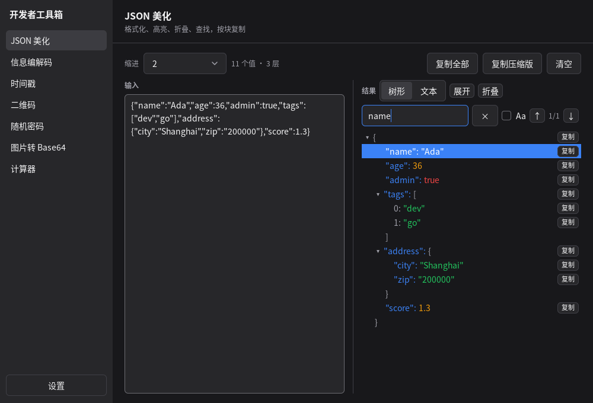
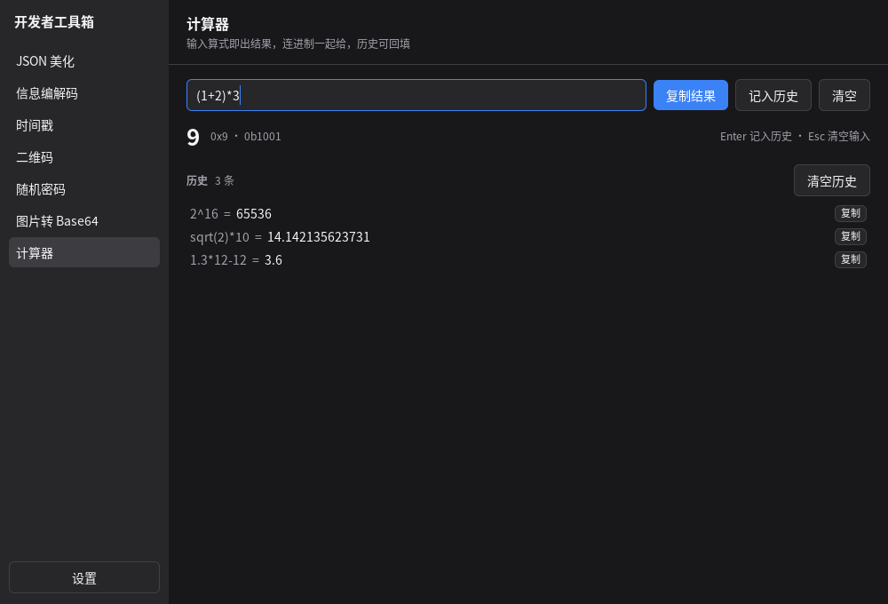
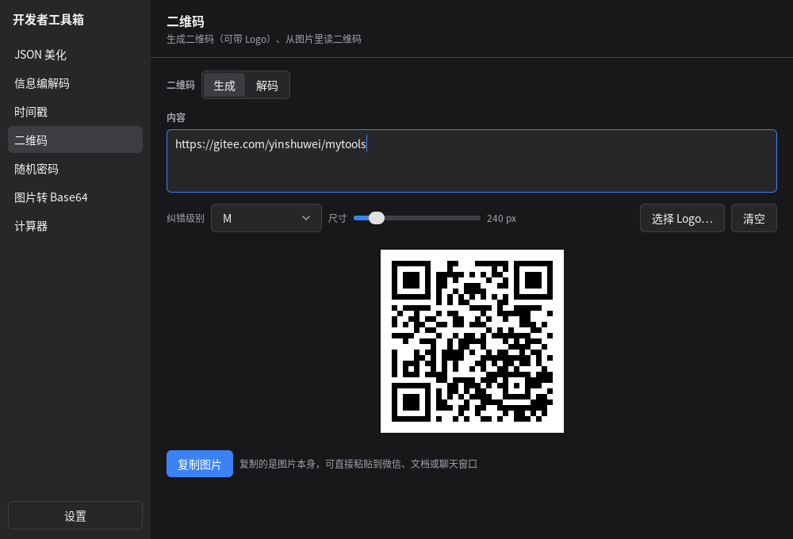
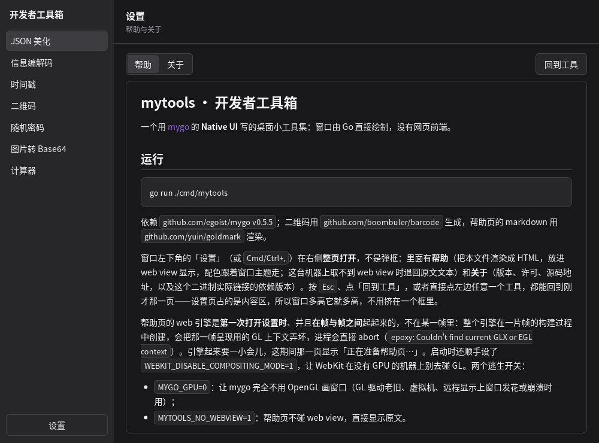
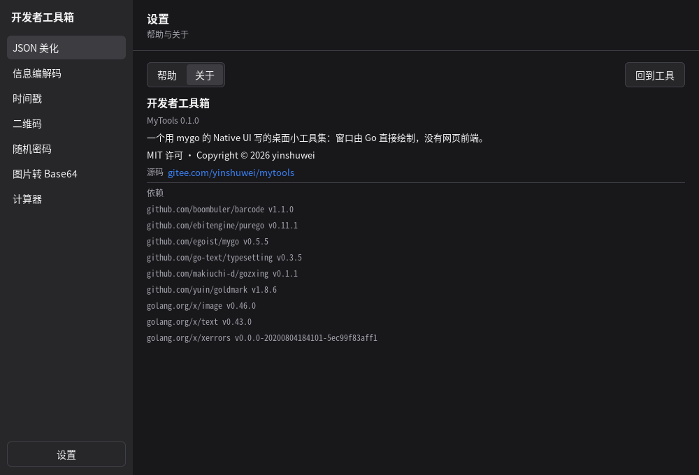

# mytools · 开发者工具箱

一个用 [mygo](https://github.com/egoist/mygo) 的 **Native UI** 写的桌面小工具集：窗口由 Go 直接绘制，没有网页前端。

## 运行

```sh
go run ./cmd/mytools
```

依赖 `github.com/egoist/mygo v0.5.5`；二维码用 `github.com/boombuler/barcode` 生成，帮助页的 markdown 用 `github.com/yuin/goldmark` 渲染。

窗口左下角的「设置」（或 `Cmd/Ctrl+,`）在右侧**整页打开**，不是弹框：里面有**外观**（颜色可选浅色 / 深色 / 跟随系统，缩放比例用拉杆调 80%–150%，文字、图标与控件一起变，立即生效并写进配置目录的 `mytools/settings.json`，下次启动照旧）、**帮助**（把本文件渲染成 HTML，放进 web view 显示，配色跟着窗口主题走；这台机器上取不到 web view 时退回原文文本）和**关于**（版本、许可、源码地址，以及这个二进制实际链接的依赖版本）。按 `Esc`、点「回到工具」，或者直接点左边任意一个工具，都能回到刚才那一页——设置页占的是内容区，所以窗口多高它就多高，不用挤在一个框里。

帮助页的 web 引擎是**第一次打开设置时**、并且**在帧与帧之间**起起来的，不在某一帧里：整个引擎在一片帧的构建过程中创建，会把那一帧呈现用的 GL 上下文弄坏，进程会直接 abort（`epoxy: Couldn't find current GLX or EGL context`）。引擎起来要一小会儿，这期间那一页显示「正在准备帮助页…」。启动时还顺手设了 `WEBKIT_DISABLE_COMPOSITING_MODE=1`，让 WebKit 在没有 GPU 的机器上别去碰 GL。两个逃生开关：

- `MYGO_GPU=0`：让 mygo 完全不用 OpenGL 画窗口（GL 驱动老旧、虚拟机、远程显示上窗口发花或崩溃时用）；
- `MYTOOLS_NO_WEBVIEW=1`：帮助页不碰 web view，直接显示原文。

## 构建

`scripts/` 下是一组编译脚本，把窗口编成各平台的独立可执行文件。MyGo 用 purego 调系统接口、不碰 cgo，所以一台机器就能给全部平台交叉编译：

```sh
scripts/build.sh                 # 全部目标，产物落在 dist/
scripts/build.sh --host          # 只编本机
scripts/build.sh -p linux/amd64  # 只编一个目标
scripts/build.sh -v 1.2.3        # 指定版本号（默认取 git 标签）
```

| 目标 | 可执行文件 |
| --- | --- |
| `linux/amd64`、`linux/arm64` | `dist/linux-*/mytools` |
| `darwin/amd64`、`darwin/arm64` | `dist/darwin-*/mytools.app` |
| `windows/amd64`、`windows/arm64` | `dist/windows-*/mytools.exe` |

每个目标各占一个 `dist/<os>-<arch>/`：可执行文件，以及运行时放在它旁边的 `resources/`；再打成 `dist/mytools-<版本>-<os>-<arch>.tar.gz`。macOS 是个例外：那里双击裸的可执行文件只会让 Finder 开一个 Terminal 去跑它，所以这个目标是完整的 `mytools.app` 包（`Contents/MacOS/mytools` + `Contents/Resources` + `Info.plist`，在有 macOS 工具链的机器上还带图标与 ad hoc 签名），双击直接开窗口。默认是发布构建——`-trimpath`、`-ldflags "-s -w"`、`-tags mygo_noinspector`（去掉 MyGo 的界面检查器），Windows 目标另加 `-H=windowsgui`，免得弹出控制台；加 `-d` 就反过来，留着调试功能与符号。

Windows 上是同一套参数，用 `scripts\build.cmd`（或直接 `scripts/build.ps1`），开关名对应为 `-Platform`、`-Version`、`-Local`、`-Debug`、`-NoArchive`。

要从系统里装——macOS 的 `.app` 与 `.dmg`、Windows 的安装包、Linux 的 `.deb` 与 `install.sh`——用 MyGo 自带的 CLI 打包：

```sh
go tool mygo build -platform darwin/universal,windows/amd64,linux/amd64
```

### 发布到 GitHub Releases

`.github/workflows/release.yml` 在推送 `v` 开头的标签时自动：

1. 跑 `go vet ./...` 与 `go test ./...`；
2. 在 Ubuntu 上编 Linux 与 Windows 目标，在 macOS 上编 macOS 目标（这样 `.app` 才有图标与 ad hoc 签名）；
3. 把 6 个 `mytools-<版本>-<os>-<arch>.tar.gz` 作为工作流产物上传，并在 Releases 里建一版附上它们。

```sh
git tag v0.1.0
git push origin v0.1.0
```

只想试一次、不建 Release：在仓库的 Actions 页选 Release → Run workflow，版本号留空就取标签或 `git describe`。标签要在推送后才会触发；`dist/` 已被忽略，本地构建不进仓库。

## 截图

**JSON 美化**：树形高亮、可折叠；`Cmd/Ctrl+F` 查找，点名字、点值、点空白各复制各的



**计算器**：边打边算，整数结果顺带给出十六进制与二进制；历史点一下就能放回输入框改



**二维码**：生成与解码，图片本身可以直接复制



**设置 · 帮助**：README 渲染成 HTML，放进 web view，配色跟着窗口走



**设置 · 关于**：版本、许可、源码，以及这个二进制实际链接的依赖



截图是拿真实页面画出来的，要重画就 `MYTOOLS_SHOTS=1 go test ./internal/app -run TestShots`（写到 `docs/`）。

## 功能

| 工具 | 说明 |
| --- | --- |
| JSON 美化 | 左输入右结果，边输边校验；结果树按类型高亮、可折叠，支持查找（`Cmd/Ctrl+F` 切回树形并把键盘放进查找框，`Esc` 清空；`*` 通配、可选区分大小写，显示「第几个/共几个」，Enter/↓ 下一个、Shift+Enter/↑ 上一个并自动展开定位）；单击即可复制——点名字复制名字，点值复制内容（字符串不带引号），点括号或行内空白复制整块，另有「复制」按钮与右键菜单；也可切换纯文本视图 |
| 信息编解码 | Base64、Base64 (URL)、URL、Hex 的编码与解码，一键把结果回填输入 |
| 时间戳 | 显示当前时间（每秒刷新）与秒 / 毫秒时间戳；时间戳与日期时间双向互转；时区可切换（默认本地，选项上标注各自的 UTC 偏移，也可自定义） |
| 二维码 | 生成：边输边生成，尺寸 120–1000px 拖动即时生效，留白按 2 个模块收紧，可在中间放 Logo（会提示改用 Q/H 纠错），可一键把图片复制到剪贴板（直接粘进微信）；解码：从图片里读二维码，也能把刚生成的码读回来自检 |
| 随机密码 | 长度与数量可调，可选大写 / 小写 / 数字 / 符号、可排除易混淆字符；一次批量生成，每行一个，可一键复制全部 |
| 图片转 Base64 | 图片 → Base64：选择本地图片，预览并输出纯 Base64 或 Data URI；Base64 → 图片：从剪贴板或文本文件读入（补全的 data URI、折了行的、没填充的 Base64 都认），显示图片并可一键复制成图片本身；预览限高 240px（按比例缩放），免得把下面的控件顶出去；两个方向里，超大图片都不预览、很长的一串也只显示开头，「复制」「保存为文件…」给到的仍是完整内容 |
| 计算器 | 边打边算：`+ - * / % ^`、括号、正负号，`0xff` / `0b1010` / `0o17` / `1_000` / `1e3` 这些写法都认，另有 `abs sqrt cbrt round floor ceil trunc exp ln log log2 min max hypot` 与 `pi e tau`；整数结果顺带给出十六进制与二进制；小数按 15 位有效数字显示（float64 能保证的位数），所以 `1.3*12-12` 是 3.6 而不是 3.6000000000000014，把鼠标停在结果上能看到浮点里真实的值；Enter 把算式与结果记入历史（最多 50 条，留在本次会话里），点历史任意一行就把那条算式放回输入框改，「复制」按钮拿的是结果 |
| Git 代码库 | 一个 Root 目录一个标签页，打开的 Root 会记住（存在用户配置目录的 `mytools/git-roots.json` 里），下次启动还在；选好目录就扫描它下面所有的 git 仓库（不进入隐藏目录、`node_modules`、`vendor` 等），按文件夹折成树，可搜索过滤、全部展开 / 全部折叠，也能重新扫描；标签上的 × 或工具栏的「关闭」关掉当前 Root，只是关掉这个标签，磁盘上的文件不动；每个仓库一行，显示当前分支、领先 / 落后远端的提交数、未提交改动与冲突；行尾的图标按钮执行 `git pull --ff-only`、`git push`（还没有上游时自动建立跟踪），把仓库在终端、文件管理器、或本机装着的编辑器里打开（自动找 VS Code、VSCodium、Cursor、Windsurf、Zed、Sublime、JetBrains 系等，按钮直接写找到的那个的名字，比如「在 VSCodium 中打开」；装了多个时点按钮可以选，选过的会记住），或单独刷新这个仓库的状态（刷新会先对远端 `git fetch --all`，领先 / 落后才是服务器上现在的数；列表上的刷新按钮对当前 Root 下所有仓库做同样的事，首次扫描只看本地、不发网络请求）——鼠标停上去有提示，没有可拉 / 可推的提交时对应按钮变灰 |
| 截图 | `Ctrl+Alt+A`（macOS `⌘⇧A`）或页面上的按钮开始：屏幕冻结后拖出区域，按 Enter，图片回到这一页编辑；工具是选择、矩形、箭头、画笔、文字、马赛克，颜色与线宽可选；画错了用「选择」点住标注就能拖动挪位置（`Delete` 删掉选中的那个），`Ctrl+Z` / `Ctrl+Shift+Z` 撤销重做；点「文字」在图上一点，输入框就浮在那里，Enter 放下、Esc 取消，页面不会因为输入框出现而上下抖动；编辑区按 1:1 显示（一个截图像素对一个屏幕像素），占满窗口宽度并带底色与边框，图片大了就用滚轮 / 滚动条浏览，不再缩放到窗口里；「复制」把标注后的图片放进剪贴板，「保存…」写成 PNG。标注按截图的原始像素渲染，Retina 上也是原分辨率。Wayland 会话暂不支持（需要 X11），macOS 首次使用要授予屏幕录制权限 |

## 快捷键

各页用同一套键，含义到哪里都一样（macOS 上是 `⌘`，其他地方是 `Ctrl`）：

| 键 | 作用 |
| --- | --- |
| `Cmd+Enter` | 按当前页面的主按钮：编码、生成、复制图片、选择图片…、从剪贴板粘贴、复制结果 |
| `Cmd+O` | 打开该页面的文件对话框：选图片、选 Base64 文本、选 Logo |
| `Cmd+S` | 保存为文件（图片转 Base64 页、截图页） |
| `Cmd+,` | 打开设置（帮助 / 关于） |
| `Cmd+Shift+Enter` | 信息编解码页的另一个方向：解码 |
| `Cmd+F` | 查找：JSON 美化页切回树形，并把键盘放进查找框；Git 代码库页把键盘放进搜索框 |
| `Cmd+Z` / `Cmd+Shift+Z` | 截图页：撤销 / 重做标注 |
| `Enter` | 计算器页：把这条算式与结果记入历史，输入框清空等着下一条；截图页：放下正在输入的文字 |
| `Delete` / `Backspace` | 截图页：删掉「选择」工具点中的标注 |
| `Esc` | 清空查找内容（JSON 美化页、Git 代码库页）；清空正在输入的算式（计算器页）；截图页：取消输入 / 放下这张图 |
| `Ctrl+Alt+A` / `⌘⇧A` | 全局快捷键：开始截图（在任何程序里都能按） |

按钮的悬停提示里都写着各自的键。输入框有键盘时这些键照样有效。

## 目录结构

```
doc.go                根包：把 README 编进二进制，供「帮助」显示
docs/                 截图：README 里贴的，「帮助」页里也是这些
cmd/mytools/          可执行入口：应用名、版本、窗口（没有菜单栏）
internal/app/         窗口外壳：侧边栏导航、页面注册与切换
internal/capture/     截屏：各平台取一块屏幕的像素（purego，不用 cgo）
internal/shots/       截图：覆盖层选区域、标注模型与按原始像素导出
internal/tools/       每个工具一个文件（求值器、文件对话框等旁支各另占一个），
                      各自持有状态并实现 tools.Tool
internal/widgets/     各工具共用的小组件（标题、结果框、复制按钮等）
scripts/              跨平台编译脚本（build.sh / build.ps1 / build.cmd）
```

## 扩展

新增一个工具：在 `internal/tools` 里加一个文件，写一个类型实现 `tools.Tool`
（`ID`、`Name`、`Desc`、`View`），再把它加进 `tools.All()`。

按需再实现三个可选接口：

- `tools.WindowAware`：需要窗口的工具（例如弹原生文件对话框），
  `App.SetWindow` 会在窗口创建后自动注入；
- `tools.FillsHeight`：自己分栏、自己滚动的页面（如 JSON 美化），
  外壳会把整个内容区交给它，而不是当成一列来滚动；
- `tools.MaxWidth`：页面最宽 `tools.PageWidth`（1000 DIP）、靠左，窗口很宽时按钮不会离内容太远；
  JSON 美化不实现它，保留整幅宽度。

按钮上挂快捷键用 `internal/tools/keys.go` 里的 `mainPressed`（主按钮，
含 `Cmd+Enter`）和 `filePressed`（文件对话框按钮，含 `Cmd+O`），
提示文字里的按键名用 `widgets.ShortcutHint` 写，macOS 与别处自动不同。

## 测试

```sh
go test ./...
```

- `internal/app`：用 `ui.NewTester` 在没有窗口的情况下渲染每个页面，
  布局或 Key 出错会直接失败；也验证侧边栏点击切换。
- `internal/tools`：JSON、编解码往返、时间解析、密码字符集、二维码生成等纯逻辑单测。

## 许可

[MIT](LICENSE)
